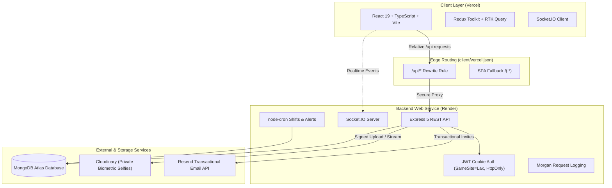

# Attendance Management System (EMS)

A full-stack, enterprise-grade Attendance Management System built with React 19, TypeScript, Node.js 20+, Express 5, and MongoDB Atlas. Features biometric selfie verification (camera only, zero file uploads), geofenced punch operations, automated 8-hour shift tracking, overtime approvals, leave management, exportable daily reports (PDF/Excel), and real-time Socket.IO synchronization.

---

## Live Deployment Links

- **Frontend Application (Vercel)**: [https://ems-client-sand.vercel.app](https://ems-client-sand.vercel.app)
- **Backend API Service (Render)**: [https://ems-server-wjey.onrender.com](https://ems-server-wjey.onrender.com)
- **API Health Check**: [https://ems-client-sand.vercel.app/api/health](https://ems-client-sand.vercel.app/api/health) (proxied through Vercel to Render)
- **GitHub Repository**: [https://github.com/kartik-malviya1/EMS](https://github.com/kartik-malviya1/EMS) (Branch: `main`)

---

## Demo Accounts (Evaluator Access)

Pre-configured demo accounts for local development and assessment demonstrations:

| Role         | Name                           | Email Address             | Demo Password      | Canonical Dashboard Route | Compatibility Alias Route |
| :----------- | :----------------------------- | :------------------------ | :----------------- | :------------------------ | :------------------------ |
| **Admin**    | Demo Admin                     | `admin@gmail.com`         | `DemoPassword@123` | `/admin`                  | `/admin/dashboard`        |
| **Manager**  | Sarah Connor (Engineering Mgr) | `manager.sarah@gmail.com` | `DemoPassword@123` | `/manager`                | `/manager/dashboard`      |
| **Employee** | Alice Walker (Engineering)     | `alice@gmail.com`         | `DemoPassword@123` | `/employee`               | `/employee/dashboard`     |

> [!IMPORTANT]
> **Demo & Development Only**: These shared static credentials are strictly for local testing and evaluator demonstrations. The seeder includes an automated safety guard that refuses to run in `NODE_ENV=production`. Never use demo credentials or hardcoded passwords in a production environment.

### Local Database Configuration & Idempotent Seeding

1. **Configure Environment Variables**:
   In `server/.env`, ensure your local or staging MongoDB connection string and JWT secret are configured:

   ```env
   NODE_ENV=development
   PORT=5000
   MONGODB_URI=mongodb://localhost:27017/attendance_db
   JWT_SECRET=your_super_secret_jwt_key_at_least_32_chars_long!
   BUSINESS_TIMEZONE=Asia/Kolkata
   CLIENT_ORIGIN=http://localhost:5173
   ```

2. **Run Idempotent Demo Seeding**:
   From the `server` directory, execute the dedicated demo seeding command:

   ```bash
   npm run seed:demo-accounts
   ```

   **Console Summary Output**:

   ```text
   Demo account seeding completed.

   Admin:    active
   Manager:  active
   Employee: active
   Team relationship: Employee assigned to Manager
   Password verification: passed for all three accounts
   Dashboard route configuration: verified
   ```

### Organizational Relationship & Scoping

- **Manager-Employee Hierarchy**: Alice Walker is linked to Sarah Connor via `managerId: Sarah._id` (using genuine MongoDB ObjectIds).
- **Team Discovery**: When Sarah logs in and accesses `/manager` or calls `GET /api/users/team`, Alice is discovered via `listTeamMembers(Sarah._id)`. All team attendance, verification, overtime, and leave workflows honor this relationship through `scope.service.js`.
- **Administrative Independence**: Demo Admin has `managerId: null` and retains system-wide administrative oversight across all users, logs, and settings.
- **Admin Workforce Restriction**: Admin accounts cannot punch in or punch out, cannot receive personal shift records, and have zero attendance records (`Attendance.countDocuments({ employeeId: Admin._id }) === 0`).

### Seeded Development Attendance & Dashboard History

The seeder populates bounded, realistic data so dashboards can be immediately evaluated:

- **Alice Walker (Employee)**:
  - **Today (Day 0)**: Live in-progress shift (punched in at 09:15 AM, active session displayed on dashboard).
  - **Yesterday (Day -1)**: Completed shift (500 mins / 8h 20m), verified **Valid** by Sarah Connor.
  - **Day -2**: Completed shift (540 mins) with **Approved Overtime** (60 mins, reviewed & approved by Sarah).
  - **Day -3**: Completed shift (570 mins) with **Pending Overtime** (90 mins, awaiting review).
  - **Day -4**: Incomplete shift (360 mins / 6h, planned half-day with manager notes).
  - **Day -5**: Completed shift with **Invalid Verification** (location discrepancy noted outside geofence).
  - **Day -6**: Missed shift (auto-closed by system).
  - **Notifications**: Overtime approval notification and attendance verification notice.
- **Sarah Connor (Manager)**:
  - Personal completed shift history for personal attendance views (`/employee`).
  - Pending overtime request notification from Alice.
- **Demo Admin**:
  - Zero attendance records. Administrative access only.

### Safe Re-Runs & Idempotency

The script is safe to run multiple times:

- Locates accounts by normalized email addresses.
- Preserves existing MongoDB ObjectIds (`_id`) and relationships.
- Does not create duplicate users, duplicate employee IDs, or duplicate attendance records (keyed by `{ employeeId, workDate }`).
- Reconciles active statuses (`accountStatus: "active"`, `isActive: true`) and validates password comparison.

---

## Architecture Overview



### Architectural Principles

1. **First-Party Cookie Isolation**: The frontend interacts exclusively with relative `/api` paths. In production, Vercel proxies all `/api/*` traffic directly to Render before falling back to the SPA index. JWT session cookies are configured with `SameSite=Lax`, `HttpOnly`, and `Secure`, avoiding cross-origin third-party cookie restrictions.
2. **Biometric Camera Verification**: Live selfies are captured via browser `MediaDevices.getUserMedia()` rendering onto HTML5 canvas. Raw file uploads (`<input type="file">`) are disabled throughout the codebase. Captured frames are streamed to private, authenticated Cloudinary storage and proxied back to authenticated reviewers through signed backend streams.
3. **Injectable Shift Schedules & Timezone Accuracy**: Work dates and timestamps are calculated in the configured `BUSINESS_TIMEZONE` (`Asia/Kolkata`) using server clock time. Shifts store schedule snapshots (`shiftStart`, `shiftEnd`, `expectedMinutes`, `graceMinutes`) to prevent retroactive disruption when organization policies update.
4. **Resilient Realtime Layer**: WebSocket events sync notifications and punch status live across active browser tabs. If WebSockets disconnect, the entire system gracefully falls back to deterministic REST queries.

---

## Features Implemented

### Mandatory Requirements (Assignment Scope)

- [x] **Secure Auth & RBAC**: JWT HttpOnly authentication, password hashing (bcrypt, cost 12), dual onboarding (public signup + invite activation), strict role gating (`admin`, `manager`, `employee`).
- [x] **Camera-Only Attendance**: Live selfie capture via camera stream, zero file upload inputs, geolocation coordinate capture (latitude, longitude, accuracy).
- [x] **8-Hour Standard Shifts**: Automatic calculation of `workedMinutes`; &ge; 480 minutes displays **Completed**, &lt; 480 minutes displays **Incomplete**, open shifts display **In Progress**.
- [x] **Overtime Requests & Approvals**: Employees can request overtime on eligible shifts; managers/admins can review, approve, or reject requests with audit logging.
- [x] **Role-Based Dashboards**:
  - **Employee**: Personal attendance history, live clocking stats, overtime request tracking.
  - **Manager**: Assigned team attendance, pending overtime reviews, team member records.
  - **Admin**: Organization-wide attendance, user management, system policy configurations.
- [x] **Attendance Validation**: Managers and Admins can view punch selfies, inspect GPS accuracy, mark records as **Valid** or **Invalid** (requires &ge; 5 character remarks), and view audit history.
- [x] **Daily Reports**: Aggregated daily reports scoped by role (Employee: self, Manager: team, Admin: all) with punch-in/out times, location, working hours, and validation status.

### Good-to-Have Requirements

- [x] **Advanced List Filtering & Pagination**: Main tables support date range filtering (`from`, `to`), role filters, text search, and server-side pagination (`page`, `limit`).
- [x] **Responsive & Accessible UI**: Clean responsive layout, clear loading skeletons, empty states, and descriptive error surfacing.

### Bonus Features

- [x] **Geofencing Enforcement**: Haversine distance calculation against configured office coordinates; configurable radius and GPS accuracy checks.
- [x] **Automated Cron Notifications**: Scheduled alerts for missed punch-in, missed punch-out, and auto-close of abandoned shifts.
- [x] **Socket.IO Real-Time Sync**: Live notification delivery and status updates across browser tabs.
- [x] **Theme Switcher**: Complete Dark Mode and Light Mode support with WCAG AA compliant contrast ratios.
- [x] **Export Formats**: Multi-sheet formatted Excel (`.xlsx`) export and landscape PDF (`.pdf`) export with KPI summary cards and distribution charts.

---

## Requirements Coverage & Audit Matrix

|   #    | Requirement                                                                        |   Status    | Where to Find It                                                                                                                                         | Verification Evidence & Notes                                                                                                                                                                                                                                                                                                                                                                                                                                                                                                                                |
| :----: | :--------------------------------------------------------------------------------- | :---------: | :------------------------------------------------------------------------------------------------------------------------------------------------------- | :----------------------------------------------------------------------------------------------------------------------------------------------------------------------------------------------------------------------------------------------------------------------------------------------------------------------------------------------------------------------------------------------------------------------------------------------------------------------------------------------------------------------------------------------------------- |
| **1**  | **Auth (Secure Login & Signup, RBAC, Protected Routes)**                           |   `DONE`    | `server/src/routes/auth.routes.js`<br>`client/src/routes/ProtectedRoute.tsx`<br>`client/src/pages/LoginPage.tsx`                                         | Verified live: public signup creates employees (HTTP 201), JWT cookies set with `HttpOnly; SameSite=Lax; Secure`. Invalid credentials yield generic 401. RBAC enforces role checks (403). `ProtectedRoute` preserves redirect location state. All 21 auth tests pass.                                                                                                                                                                                                                                                                                        |
| **2**  | **Attendance (Punch In/Out, Live Selfie, Geolocation, Stored Data)**               |   `DONE`    | `server/src/routes/attendance.routes.js`<br>`client/src/components/employee/PunchCard.tsx`<br>`client/src/components/employee/CameraCapture.tsx`         | Verified: 0 occurrences of `<input type="file">`. Live camera stream drawn to `<canvas>` (JPEG 0.8). Server validates coordinates & accuracy. Stored: `punchIn.at`, `punchOut.at`, `location`, `workedMinutes`, and Cloudinary private selfie URLs. All 24 attendance tests pass.                                                                                                                                                                                                                                                                            |
| **3**  | **Working Hours (8h Standard Shift: Completed vs Incomplete)**                     |   `DONE`    | `server/src/services/attendance.service.js`<br>`server/src/utils/time.js`<br>`client/src/components/common/StatusBadge.tsx`                              | Tested boundary conditions: 479 min &rarr; `incomplete`, 480 min &rarr; `completed`, 481 min &rarr; `completed`. Status badges render `Completed (8h+)` and `Incomplete (<8h)` with WCAG-compliant colors. All tests in `workingHours.test.js` pass.                                                                                                                                                                                                                                                                                                         |
| **4**  | **Overtime (Employee Request, Manager/Admin Review, Visibility)**                  |   `DONE`    | `server/src/routes/overtime.routes.js`<br>`client/src/components/employee/OvertimeModal.tsx`<br>`client/src/components/manager/OvertimeReviewDialog.tsx` | Verified: Employees can request overtime only on completed shifts (&ge;480 min). Scoped review queue (`/api/overtime/pending`). Managers approve/reject assigned team requests; Admins review system-wide. Overtime status is visible in employee history and management dashboards.                                                                                                                                                                                                                                                                         |
| **5**  | **Dashboards (Employee, Manager, Admin Views)**                                    |   `DONE`    | `server/src/controllers/dashboard.controller.js`<br>`client/src/pages/employee/`<br>`client/src/pages/manager/`<br>`client/src/pages/admin/`             | Verified: `GET /api/dashboard/summary` dynamically returns role-scoped stats. Employee dashboard displays personal attendance, live ticking digital clock, and overtime tracking. Manager dashboard displays team attendance and pending reviews. Admin dashboard displays all users and system-wide attendance.                                                                                                                                                                                                                                             |
| **6**  | **Attendance Validation (Selfie Viewing, Valid/Invalid, Remarks)**                 |   `DONE`    | `server/src/routes/attendance.routes.js`<br>`client/src/components/manager/AttendanceReviewDialog.tsx`                                                   | Verified: Managers and Admins can view employee selfies via authorized streaming (`/api/attendance/:id/selfies/:kind`). Marking invalid strictly requires &ge; 5 characters remarks. History logged in `verification.history`. Review outcome badges are visible to employee and in reports.                                                                                                                                                                                                                                                                 |
| **7**  | **Reports (Daily Reports, Scoped Access, Formats)**                                | `DEVIATION` | `server/src/services/report.service.js`<br>`server/src/routes/report.routes.js`<br>`client/src/pages/reports/ReportsPage.tsx`                            | **Deliberate Design Deviation**: The assignment lists "Selfie" in reports. To keep exported reports performant, printable (landscape A4 PDF / Excel), and privacy-preserving, reports display the attendance validity outcome (Valid / Invalid / Pending review) rather than embedding raw image thumbnails, while full selfies remain accessible on-demand in the validation dialog via authenticated backend streaming (`/api/attendance/:id/selfies/:kind`). Scoping verified: Employee (own records), Manager (assigned team only), Admin (all records). |
| **8**  | **Good to Have (Filters, Pagination, UX)**                                         |   `DONE`    | `server/src/services/report.service.js`<br>`client/src/components/common/Pagination.tsx`<br>`client/src/pages/reports/ReportsPage.tsx`                   | Verified: Server-side pagination (`page`, `limit`) and filters (date range `from`/`to`, `userId`, `role`) implemented on reports, attendance history, users directory, and notifications. Loading skeletons, empty states, and error alerts present.                                                                                                                                                                                                                                                                                                         |
| **9**  | **Bonus Features (Geofencing, Notifications, Socket.IO, Dark Mode, Exports)**      |   `DONE`    | `server/src/services/geofence.service.js`<br>`server/src/socket/index.js`<br>`server/src/services/report.service.js`<br>`client/src/features/theme/`     | Verified end-to-end: Geofence validates coordinates against office coords (Haversine formula, 422 if outside); Idempotent cron jobs generate missed shift alerts; Socket.IO syncs live updates across tabs; Dark mode toggle with persistent local storage; Multi-sheet Excel and A4 landscape PDF exports with metric cards.                                                                                                                                                                                                                                |
| **10** | **Tech Stack (React 19 + Vite, RTK Query, Node 20+, Express 5, Mongoose, Morgan)** |   `DONE`    | `client/package.json`<br>`server/package.json`<br>`server/src/app.js`                                                                                    | Verified active dependencies and runtime. Morgan request logging active in non-test environments (`app.use(morgan(morganFormat))`). MongoDB Mongoose schemas with strict types. RTK Query handles all client REST data fetching with cache tags.                                                                                                                                                                                                                                                                                                             |
| **11** | **Deployment (Vercel Frontend, Render Backend)**                                   |   `DONE`    | `client/vercel.json`<br>`https://ems-client-sand.vercel.app`<br>`https://ems-server-wjey.onrender.com`                                                   | Verified live: Both frontend and backend responding HTTP 200 on `/api/health`. Vercel proxies `/api/*` to Render with same-origin cookie preservation. Public signup tested live.                                                                                                                                                                                                                                                                                                                                                                            |
| **12** | **Submission & Hygiene (Public GitHub Repo, Clean Commits, No Secrets)**           |   `DONE`    | Repository root<br>`README.md`<br>`.gitignore`                                                                                                           | Verified: Public GitHub repository with zero tracked secrets (verified via git history scan). Correct `.gitignore`. Committed lockfiles. Node engine requirement set (`>=20.0.0`).                                                                                                                                                                                                                                                                                                                                                                           |
| **13** | **Evaluation Criteria Quick Pass (Core Flows, Error Handling, Structure)**         |   `DONE`    | `server/src/middleware/errorHandler.js`<br>`server/src/validators/`<br>`client/src/pages/`                                                               | Verified: Error handling and Zod validation tested with invalid payloads on 5 endpoints. Clean modular separation across controllers, services, models, validators, and frontend slices. Clear loading/empty/error states on all primary pages.                                                                                                                                                                                                                                                                                                              |

---

## Role-Based Access Control (RBAC) Matrix

| Feature / Resource                     | Unauthenticated | Employee  |     Manager      |      Admin      |
| :------------------------------------- | :-------------: | :-------: | :--------------: | :-------------: |
| Public Signup & Login                  |       Yes       |     —     |        —         |        —        |
| Accept Invitation & Activate Account   |       Yes       |     —     |        —         |        —        |
| Punch In & Punch Out (Camera + GPS)    |       No        |    Yes    | Yes (Assumption) | No (Admin only) |
| View Personal Attendance & Overtime    |       No        |    Yes    |       Yes        |       No        |
| Request Overtime                       |       No        |    Yes    |       Yes        |       No        |
| View Team Attendance & Overtime Queue  |       No        |    No     | Yes (Team scope) |    Yes (All)    |
| Review / Validate Attendance Records   |       No        |    No     | Yes (Team scope) |    Yes (All)    |
| Approve / Reject Overtime Requests     |       No        |    No     | Yes (Team scope) |    Yes (All)    |
| Apply for Leave & Cancel Pending       |       No        |    Yes    |       Yes        |       No        |
| Review Leave Applications              |       No        |    No     | Yes (Team scope) |    Yes (All)    |
| Manage Users & Roles (`/admin/users`)  |       No        |    No     |        No        |       Yes       |
| Configure Attendance Policy & Geofence |       No        |    No     |        No        |       Yes       |
| Send & Inspect Email Invitations       |       No        |    No     | Yes (Team scope) |    Yes (All)    |
| Export Daily Attendance (PDF/Excel)    |       No        | Yes (Own) |    Yes (Team)    |    Yes (All)    |

---

## API Overview

All API endpoints are mounted under `/api` and return standardized responses:

- **Success**: `{ "success": true, "data": ..., "meta"?: { ... } }`
- **Error**: `{ "success": false, "error": { "code": "STRING_CODE", "message": "...", "details"?: [...] } }`

### Summary of Routes

```
GET    /api/health                                Public health check
GET    /api/auth/config                           Public registration feature flag (creates employee)
POST   /api/auth/login                            Authentication & session cookie dispatch
POST   /api/auth/logout                           Session invalidation & cookie clear
GET    /api/auth/me                               Get authenticated profile
GET    /api/auth/socket-token                     Generate short-lived 60s WebSocket token
POST   /api/auth/invitations/request-link        Self-service invitation retrieval
POST   /api/auth/invitations/validate            Token validation before activation
POST   /api/auth/accept-invitation                Password configuration & activation

GET    /api/attendance/today                      Today's active attendance record
GET    /api/attendance/me                         Personal attendance history (paginated)
GET    /api/attendance/team                       Manager team attendance history
GET    /api/attendance                            Admin system-wide attendance records
POST   /api/attendance/punch-in                   Punch in (multipart: selfie, lat, lng, accuracy)
POST   /api/attendance/punch-out                  Punch out (multipart: selfie, lat, lng, accuracy)
GET    /api/attendance/:id/selfies/:kind          Stream authorized biometric selfie
PATCH  /api/attendance/:id/verify                 Validate record (Valid / Invalid + remarks)

POST   /api/overtime/request                      Submit overtime request for shift
GET    /api/overtime/pending                      List pending overtime reviews (scoped)
PATCH  /api/overtime/:id/review                   Approve or reject overtime request

GET    /api/reports/daily                         Daily attendance aggregated report
GET    /api/reports/daily/export                  Export report (format=xlsx or format=pdf)

GET    /api/dashboard/summary                     Role-specific dashboard metrics & KPIs

GET    /api/users                                 Admin user directory
GET    /api/users/team                            Manager team directory
GET    /api/users/managers                        Active managers lookup
PATCH  /api/users/:id                             Update user role, status, or manager

GET    /api/settings/geofence                     Get geofence configuration
PUT    /api/settings/geofence                     Update geofence configuration

GET    /api/notifications                         Paginated user notifications
GET    /api/notifications/unread-count            Unread notifications count
PATCH  /api/notifications/:id/read                Mark notification as read
PATCH  /api/notifications/read-all                Mark all notifications as read

POST   /api/leave                                 Apply for leave
GET    /api/leave/me                              Personal leave requests
GET    /api/leave/team                            Manager team leave requests
GET    /api/leave                                 Admin all leave requests
PATCH  /api/leave/:id/cancel                      Cancel pending leave
PATCH  /api/leave/:id/review                      Approve or reject leave application
```

---

## Environment Variables (Names Only)

### Backend Environment Variables (`server/.env`)

| Variable Name                  |  Required   | Purpose                                                                |
| :----------------------------- | :---------: | :--------------------------------------------------------------------- |
| `NODE_ENV`                     |     Yes     | Application environment (`development`, `production`, `test`)          |
| `PORT`                         |     Yes     | HTTP listening port (default: `5000`)                                  |
| `MONGODB_URI`                  |     Yes     | MongoDB connection string (Atlas in production)                        |
| `JWT_SECRET`                   |     Yes     | Cryptographic secret for signing session and socket tokens             |
| `JWT_EXPIRES_IN`               |     No      | Session duration (default: `12h`)                                      |
| `CLIENT_ORIGIN`                |     Yes     | Allowed frontend origin for CORS and CSRF defense                      |
| `APP_BASE_URL`                 |     Yes     | Canonical frontend URL used to build invitation links                  |
| `BUSINESS_TIMEZONE`            |     No      | Business timezone for date/time computations (default: `Asia/Kolkata`) |
| `STANDARD_SHIFT_MINUTES`       |     No      | Standard shift duration in minutes (default: `480`)                    |
| `WORKING_DAYS`                 |     No      | Working days of week (default: `1,2,3,4,5` for Mon–Fri)                |
| `ENABLE_CRON`                  |     No      | Enable node-cron scheduled shift jobs (default: `true`)                |
| `ALLOW_PUBLIC_REGISTRATION`    |     No      | Feature flag controlling self-service signup (default: `true`)         |
| `CLOUDINARY_CLOUD_NAME`        |     Yes     | Cloudinary account cloud name for selfie storage                       |
| `CLOUDINARY_API_KEY`           |     Yes     | Cloudinary API key                                                     |
| `CLOUDINARY_API_SECRET`        |     Yes     | Cloudinary API secret                                                  |
| `CLOUDINARY_FOLDER`            |     No      | Target folder for uploaded selfies (default: `attendance`)             |
| `GEOFENCE_ENABLED`             |     No      | Toggle geofence enforcement on punch operations                        |
| `GEOFENCE_OFFICE_LAT`          | Conditional | Latitude of designated office location                                 |
| `GEOFENCE_OFFICE_LNG`          | Conditional | Longitude of designated office location                                |
| `GEOFENCE_RADIUS_METERS`       |     No      | Permitted radius around office (default: `200`)                        |
| `GEOFENCE_MAX_ACCURACY_METERS` |     No      | Maximum permitted GPS accuracy reading (default: `100`)                |
| `ADMIN_NAME`                   |     No      | Name for seeded administrator                                          |
| `ADMIN_EMAIL`                  |     No      | Email address for seeded administrator                                 |
| `ADMIN_PASSWORD`               |     No      | Password for seeded administrator                                      |
| `EMAIL_PROVIDER`               |     No      | Email driver (`resend`)                                                |
| `RESEND_API_KEY`               | Conditional | Resend API key for transactional invitations (`re_...`)                |
| `EMAIL_FROM`                   | Conditional | Sender address (e.g. `EMS Portal <onboarding@resend.dev>`)             |
| `INVITATION_EXPIRY_HOURS`      |     No      | Invitation token lifespan in hours (default: `72`)                     |

### Frontend Environment Variables (`client/.env`)

| Variable Name       | Required | Purpose                                                                                |
| :------------------ | :------: | :------------------------------------------------------------------------------------- |
| `VITE_API_BASE_URL` |   Yes    | Base URL for API requests (`/api` for same-origin proxy rewrites)                      |
| `VITE_SOCKET_URL`   |   Yes    | WebSocket root URL (`https://ems-server-wjey.onrender.com` or `http://localhost:5000`) |

---

## Setup & Running Locally

### Prerequisites

- Node.js &gt;= 20.0.0
- npm &gt;= 10.0.0
- MongoDB instance (local or Atlas)
- Cloudinary credentials (free tier)

### 1. Backend Setup

```bash
cd server
cp .env.example .env
# Edit .env with your MONGODB_URI and Cloudinary credentials

npm install
npm run seed:admin
npm run seed:demo
npm run dev
# Server starts on http://localhost:5000
```

### 2. Frontend Setup

```bash
cd client
cp .env.example .env
# Default .env is configured with VITE_API_BASE_URL=/api and VITE_SOCKET_URL=http://localhost:5000

npm install
npm run dev
# Client starts on http://localhost:5173 with Vite proxying /api to localhost:5000
```

---

## Testing & Quality Assurance

Both server and client include comprehensive automated test suites that run independently of external services.

### Running Backend Tests

```bash
cd server
npm test
# Runs 16 test files (268 unit and integration tests) using Vitest and mongodb-memory-server
npm run lint
# Validates code style with ESLint
```

### Running Frontend Tests

```bash
cd client
npm test
# Runs 13 test files (55 component and flow tests) using Vitest and JSDOM
npm run build
# Runs TypeScript compiler (tsc -b) and production bundle build
npm run lint
# Validates frontend linting
```

---

## Deployment Checklist & Dashboard Steps

### 1. Vercel Frontend Configuration (`client`)

- **Root Directory**: `client`
- **Framework Preset**: `Vite`
- **Build Command**: `npm run build`
- **Output Directory**: `dist`
- **Environment Variables**:
  - `VITE_API_BASE_URL` = `/api`
  - `VITE_SOCKET_URL` = `https://ems-server-wjey.onrender.com`
- **API Rewrite Rule (`client/vercel.json`)**:
  ```json
  {
    "rewrites": [
      {
        "source": "/api/:path*",
        "destination": "https://ems-server-wjey.onrender.com/api/:path*"
      },
      {
        "source": "/(.*)",
        "destination": "/"
      }
    ]
  }
  ```

### 2. Render Backend Web Service (`server`)

- **Root Directory**: `server`
- **Environment**: `Node.js`
- **Build Command**: `npm install`
- **Start Command**: `npm start`
- **Health Check Path**: `/api/health`
- **Environment Variables**: Configure the environment variable names documented above.

### 3. MongoDB Atlas Configuration

- In **Network Access**, ensure Render can communicate with Atlas (add Render outbound IPs or `0.0.0.0/0` with strong authentication).

---

## Assumptions

1. **Manager Self-Attendance**: Managers punch in and out using the same attendance interface as employees (the assignment describes employee punch operations; manager attendance is an implementation assumption).
2. **Admin Administrative Exclusivity**: Admin accounts are administrative-only: they do not punch in/out, have no personal attendance records, and cannot request overtime.
3. **Midnight Shift Boundary**: Shifts crossing business midnight are not supported.
4. **Dynamic Scope Evaluation**: Authority over pending reviews is evaluated at request time. If an employee is reassigned to a new manager, pending requests transfer to the new manager.
5. **Business Timezone**: All shift calculations, work dates, and timestamps are generated server-side in `BUSINESS_TIMEZONE` (`Asia/Kolkata`).
6. **One Record per Day**: Exactly one attendance record is created per employee per business work date.
7. **Floor Minutes & No Breaks**: `workedMinutes = floor((punchOut - punchIn)/60000)` without unpaid break deductions.
8. **Overtime Threshold**: Overtime begins immediately when worked minutes exceed 480 minutes (8 standard hours).
9. **Reviewer Scope Matrix**: Employee records are reviewed by their assigned manager or any admin. Manager records are reviewed by admins only. Self-review is strictly forbidden (HTTP 403).
10. **Lazy Auto-Close**: Lazy auto-close on subsequent punch attempts handles server sleep gaps on free hosting tiers.
11. **Single-Instance Cron**: Scheduled jobs assume a single running instance.
12. **Same-Origin Proxy Cookies**: JWT cookies are first-party through dev proxy locally and Vercel proxy rewrites in production.
13. **Biometric Privacy**: Cloudinary images are authenticated and private; image binaries are streamed exclusively through authorized backend endpoints.
14. **Dual Onboarding**: Public signup (`ALLOW_PUBLIC_REGISTRATION=true`) coexists with invite-only team activation.
15. **Resend Sandbox Mode**: Test sender `onboarding@resend.dev` delivers only to the Resend account owner's email address. External recipients require a verified domain.
16. **Accepted vs Delivered**: An `accepted` status indicates provider dispatch; inbox delivery is confirmed via message query.
17. **Webhook Omission**: Asynchronous push webhooks are omitted in favor of pull-based delivery checks to avoid public endpoint dependency during evaluation.
18. **Zero Simulation**: All invitation workflows dispatch real emails through Resend; mock delivery paths have been eliminated.
19. **APP_BASE_URL Routing**: Invitation links use `APP_BASE_URL` to route recipients to the production Vercel domain.

---

## Known Limitations

1. **Render Free Tier Cold Starts**: Render puts idle web services to sleep after 15 minutes of inactivity. The initial wake-up request can take 30–50 seconds to respond.
2. **Camera Hardware Dependency**: Punching in and out requires an active camera device with browser media permissions. File uploads are intentionally omitted per assignment specifications.
3. **Single Timezone per Deployment**: Shift calculations use `BUSINESS_TIMEZONE` globally across the organization. Multi-timezone distributed shifts are not supported.

---

## Troubleshooting

| Status Code                 | Cause                                                                                                                                                        | Resolution                                                                                                                                                                                                                        |
| :-------------------------- | :----------------------------------------------------------------------------------------------------------------------------------------------------------- | :-------------------------------------------------------------------------------------------------------------------------------------------------------------------------------------------------------------------------------- |
| **404 / 405 (on `/api/*`)** | **Vercel rewrite misconfigured**: Vercel serves HTML or returns 405 because the `/api/:path*` rewrite to Render is missing or listed after the SPA fallback. | Confirm `client/vercel.json` lists `{"source": "/api/:path*", "destination": "https://ems-server-wjey.onrender.com/api/:path*"}` **before** `{"source": "/(.*)", "destination": "/"}`. Confirm Vercel Root Directory is `client`. |
| **502 / 504**               | **Render instance cold start**: Render free tier is waking from sleep.                                                                                       | Access `https://ems-server-wjey.onrender.com/api/health` in a browser to wake the service, or configure an external ping monitor.                                                                                                 |
| **403 BAD_ORIGIN**          | **CORS / CSRF origin mismatch**: Non-GET request origin does not match `CLIENT_ORIGIN`.                                                                      | Ensure `CLIENT_ORIGIN=https://ems-client-sand.vercel.app` on the Render dashboard.                                                                                                                                                |
| **401 INVALID_CREDENTIALS** | **Database credentials mismatch**: Production Atlas database lacks seeded demo accounts.                                                                     | Run the non-destructive seeding commands locally targeting your Atlas database.                                                                                                                                                   |

---

&copy; 2026 Attendance Management System. All rights reserved.
